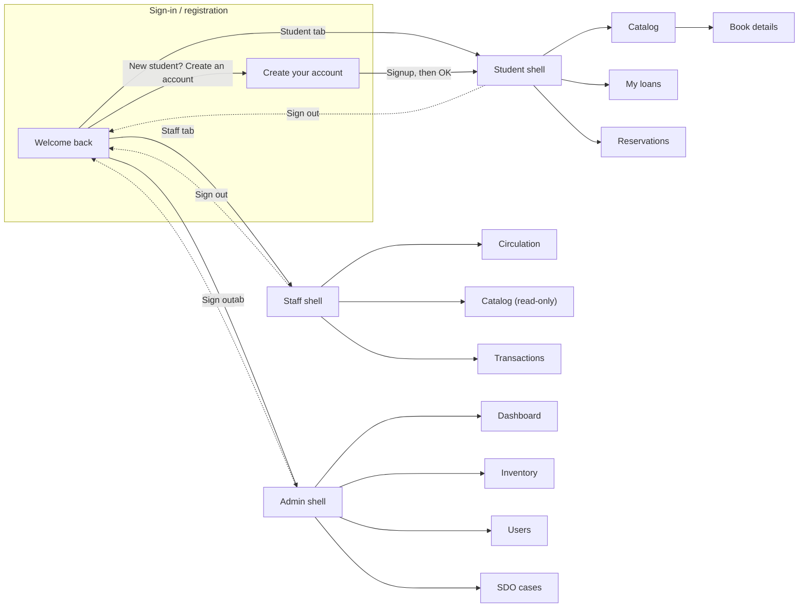
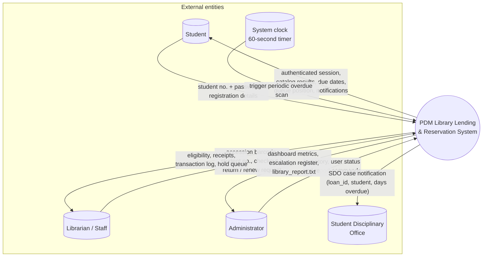
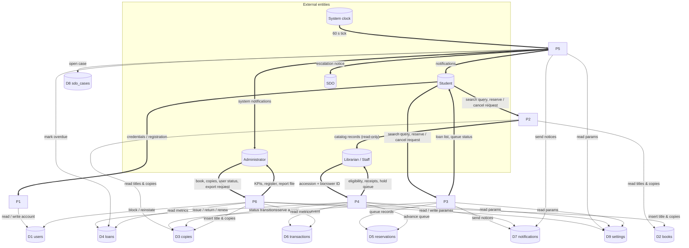
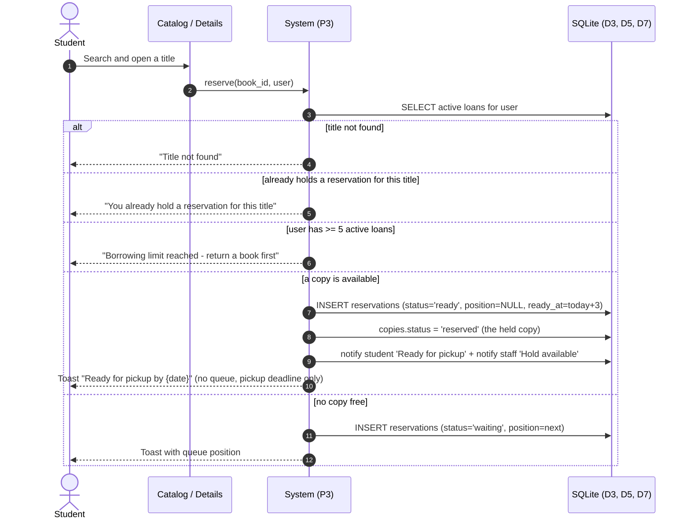
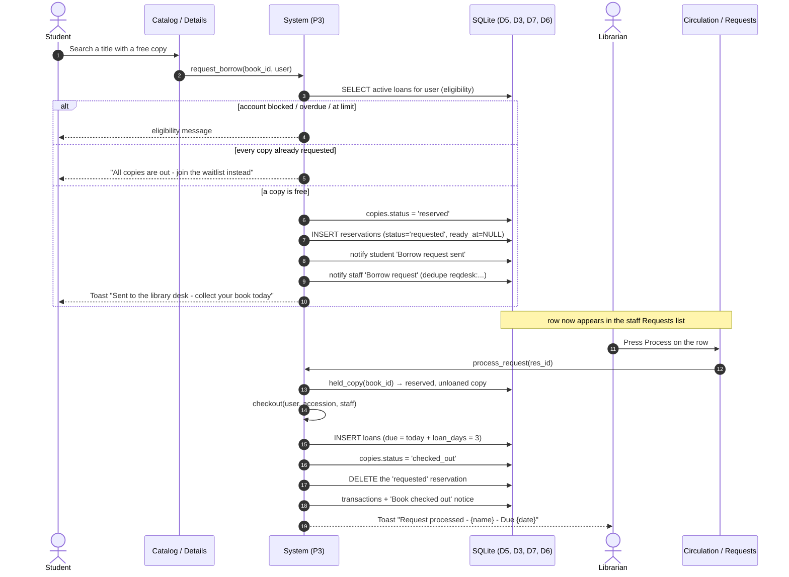
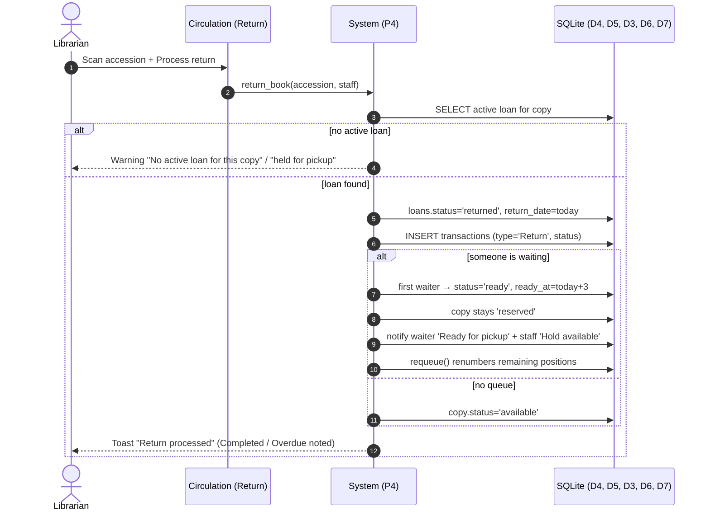
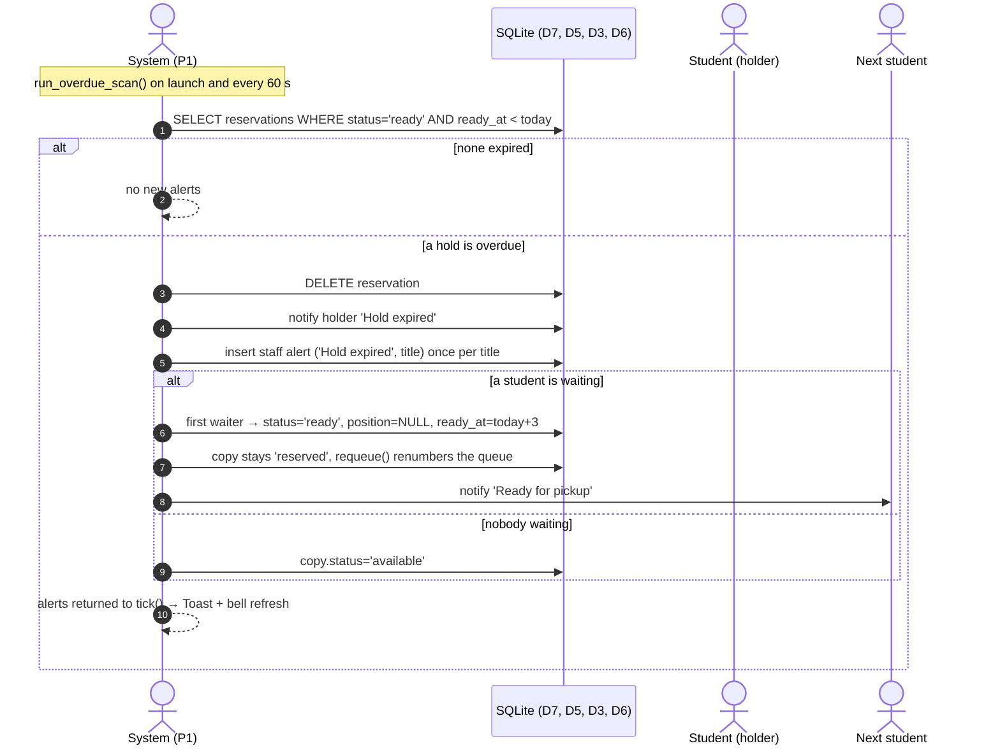
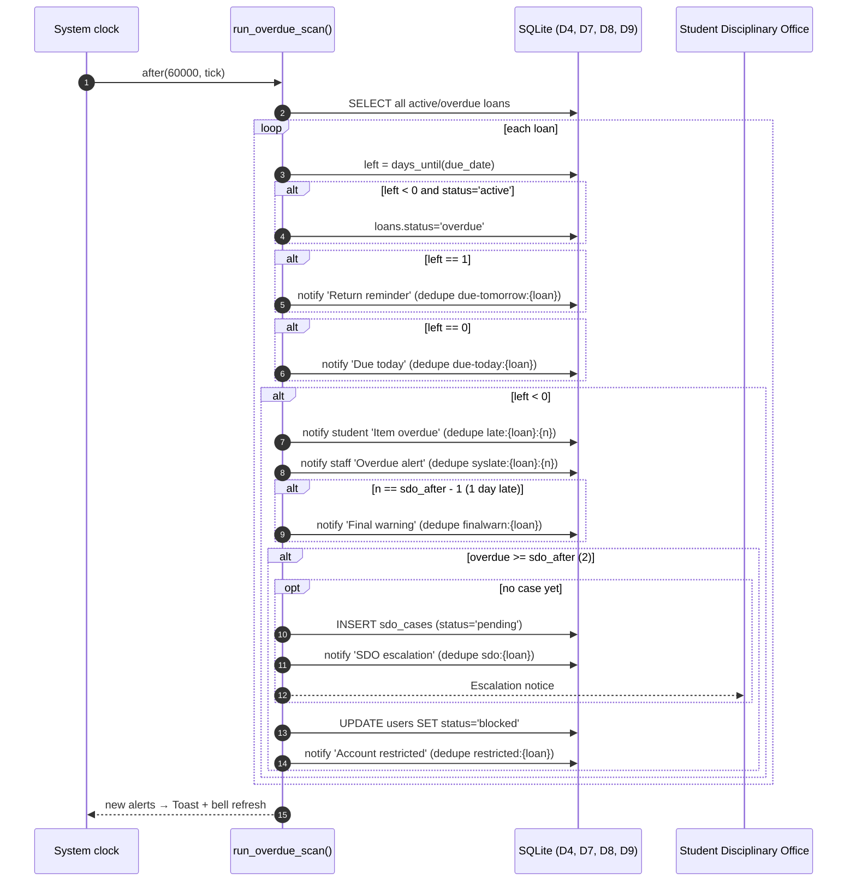

# PDM Library Lending Books & Reservation System — Workflow & Data Flow Documentation

**Application:** `library_system.py` (single-file Tkinter desktop app + SQLite `library.db`)
**Run:** `py library_system.py`
**Scope:** student self-registration, catalog browsing, reservations, circulation (checkout / return / renew), inventory, user administration, overdue & SDO escalation, reporting.

---

## Table of contents

1. [System overview](#1-system-overview)
2. [Roles, screens and navigation](#2-roles-screens-and-navigation)
3. [Data Flow Diagram — Context (Level 0)](#3-data-flow-diagram--context-level-0)
4. [Data Flow Diagram — Level 1](#4-data-flow-diagram--level-1)
5. [Data dictionary (stores and flows)](#5-data-dictionary-stores-and-flows)
6. [Workflow A — Student (from login)](#6-workflow-a--student-from-login)
7. [Workflow B — Librarian / Staff](#7-workflow-b--librarian--staff)
8. [Workflow C — Administrator](#8-workflow-c--administrator)
9. [Sequence diagrams (borrow → return)](#9-sequence-diagrams-borrow--return)
10. [Automatic / background processes](#10-automatic--background-processes)
11. [Business rules and thresholds](#11-business-rules-and-thresholds)
12. [End-to-end demo script](#12-end-to-end-demo-script)
13. [Known behaviour notes](#13-known-behaviour-notes)

---

## 1. System overview

The system is a single desktop application with three layers:

| Layer | Implementation |
|---|---|
| Presentation | Tkinter screens registered in `SCREENS`, routed by `Shell.navigate()` |
| Logic | Business functions in the same file: `eligibility`, `checkout`, `return_book`, `requeue`, `renew_loan`, `reserve`, `cancel_reservation`, `run_overdue_scan`, `dashboard_stats`, `escalation_buckets` |
| Storage | SQLite database `library.db`, created and seeded automatically on first launch (`init_db`) |

**Startup chain:** `App.__init__` → `Database()` → `init_db()` (schema + seed) → `run_overdue_scan()` → `build_login()` → `after(2000, tick)` (overdue scan every 60 s).

**Authentication:** `attempt_login` looks up the ID in `users`, compares the hashed password, then confirms the selected role tab matches `users.role`. A mismatch produces:

> *This account is registered as Student — select the matching role tab.*

**Session:** a successful login calls `open_shell(user)`, which builds the `Shell`, runs `run_overdue_scan()` again, and shows a *"Library update — N new notification(s)"* toast if unread notifications exist.

**Seeded demo credentials** (created on the first launch; student passwords are their birth dates). Seeding runs **only on a fresh database** — `init_db()` returns early once any `users` row exists, so editing the `STAFF` / `ADMINS` lists does not change an existing `library.db` (see §13):

| Role | ID | Password | Name |
|---|---|---|---|
| Student | `2024-01842` | `03152005` | Alyssa M. Reyes |
| Student | `2023-00615` | `07222004` | Joshua P. Lim |
| Staff | `teope` | `pdmstaff` | Christopher Teope |
| Staff | `soy` | `pdmstaff` | Soy Delacruz |
| Staff | `karen` | `pdmstaff` | Karen Bautista |
| Staff | `janine` | `pdmstaff` | Janine Cruz |
| Administrator | `admin` | `pdmadmin` | Mae Ann D.C Basa |

---

## 2. Roles, screens and navigation

| Role | Sidebar navigation (label) | Screens |
|---|---|---|
| **Student** | Catalog ☰ · My loans ▤ · Reservations ⚑ | `catalog`, `details`, `loans`, `reservations` |
| **Staff (librarian)** | Circulation ⇄ · Catalog ☰ · Transactions ≣ | `circulation`, `catalog` (read-only), `transactions` |
| **Administrator** | Dashboard ▦ · Inventory ▥ · Users ◉ · SDO cases ⚑ | `dashboard`, `inventory`, `users`, `cases` |

Screen titles (`TITLES`):

| Key | Title | Subtitle |
|---|---|---|
| `catalog` | Library catalog | Search the collection across the PDM shelves |
| `details` | Book details | Catalog record, copies and availability |
| `loans` | My loans & reservations | Track due dates, renewals, holds and your borrowing status |
| `reservations` | Reservations | Queue positions update automatically after each return |
| `circulation` | Circulation workspace | Process borrow requests, pickups, returns and renewals at the library desk |
| `transactions` | Transaction log | Every circulation event recorded at the desk |
| `dashboard` | Library administration | Operational overview of the PDM collection |
| `inventory` | Inventory overview | Live copy availability and shelf location |
| `users` | Users | Students, library staff and borrowing status |
| `cases` | Overdue & SDO escalation | Cases requiring disciplinary follow-up |

Persistent header elements: application mark, current screen title, notification **bell** with unread badge, **Sign out** (asks *"End this session?"*, then returns to `build_login`). Persistent sidebar footer: the signed-in avatar, name and username, a gold **Change password** link (all roles — see A.8), and the **↪ Sign out** marker.

---

## 3. Data Flow Diagram — Context (Level 0)

The whole application is shown as one process. External entities are the three human roles plus the Student Disciplinary Office (SDO), which receives escalation notices, and the operating system clock that drives the periodic scan.

**Flow descriptions**

| # | From → To | Data |
|---|---|---|
| F1 | Student → System | Credentials (ID + password) or registration payload (student no., name, program, year, password) |
| F2 | System → Student | Session, catalog results, availability, loan due dates, reservation queue position, in-app notifications |
| F3 | Staff → System | Accession barcode, borrower ID, checkout / return / renew commands |
| F4 | System → Staff | Eligibility verdict, return status, recent transactions, hold queue |
| F5 | Administrator → System | Add-book form, block/reinstate command, export request |
| F6 | System → Administrator | KPI counters, weekly chart, escalation buckets, `library_report.txt` |
| F7 | System → SDO | Escalation notice for a loan overdue ≥ 2 days, when the account is restricted |
| F8 | Clock → System | Periodic trigger for `run_overdue_scan()` |

---

## 4. Data Flow Diagram — Level 1

Six processes decompose the system. Data stores are the nine SQLite tables.

**Process specification**

| ID | Process | Inputs | Outputs | Reads | Writes | Main rules |
|---|---|---|---|---|---|---|
| **P1** | Authentication & registration | Credentials; registration form | Authenticated session, new account row | D1 | D1 | Password hash match; role tab must match `role`; signup validates format `\d{4}-\d{6}`, uniqueness, real name, program/year, password ≥ 6 and confirmation |
| **P2** | Catalog search & browse | Free-text query, search-in field, availability/material/subject/year filters, sort choice | Result list, availability pills | D2, D3 | — | Read-only for staff and admin; students also see reserve/waitlist actions |
| **P3** | Reservation management | Reserve / cancel request | Queue position, "Ready for pickup" notice, staff hold notice | D3, D5, D7, D9 | D3, D5, D7 | One reservation per student per title; blocked if ≥ 5 active loans; ready holds expire after `HOLD_DAYS = 3` |
| **P4** | Circulation processing | Borrower ID, accession barcode(s) | Loan rows, return status, transaction rows, queue advance | D1, D3, D4, D5, D6, D7, D9 | D3, D4, D5, D6, D7 | Eligibility gate (active, < 5 loans, 0 overdue); due = today + 3; return may promote the first waiter |
| **P5** | Overdue monitoring & escalation | Clock tick, loan table | Overdue flags, student reminders, staff alerts, SDO cases | D4, D7, D8, D9 | D4, D7, D8 | Notices at **1 day** and **0 days** before due; overdue flag when `days_until < 0`; final warning at 1 day overdue; SDO case **and** `users.status='blocked'` at ≥ 2 days overdue (case once per loan) |
| **P6** | Administration & reporting | Add-book form, block/reinstate, export command | Catalog rows, copy accessions, status changes, `library_report.txt` | D1, D2, D3, D4, D6, D9 | D1, D2, D3 | Auto-accession `PDM-xxxxxx`; admins cannot be blocked; report written to the app folder |

---

## 5. Data dictionary (stores and flows)

### 5.1 Data stores

| Store | Table | Key columns | Purpose |
|---|---|---|---|
| D1 | `users` | `username` (student no. / staff / admin ID), `name`, `role`, `password` (hashed), `program`, `year_level`, `section` (A–D), `status` (`active`/`blocked`), `joined` | Accounts for all three roles |
| D2 | `books` | `title`, `author`, `subject`, `category`, `publisher`, `edition`, `year`, `isbn`, `call_no`, `material_type`, `description` | Bibliographic records |
| D3 | `copies` | `book_id`, `accession` (`PDM-xxxxxx`), `shelf`, `status` (`available`/`reserved`/`checked_out`) | Physical items on the shelf |
| D4 | `loans` | `copy_id`, `user_id`, `checkout_date`, `due_date`, `return_date`, `renewals`, `status` (`active`/`overdue`/`returned`) | Circulation state of each copy |
| D5 | `reservations` | `book_id`, `user_id`, `position`, `status` (`requested`/`waiting`/`ready`), `created_at`, `ready_at`, `UNIQUE(book_id,user_id)` | Borrow requests, hold queue and pickups per title |
| D6 | `transactions` | `ts`, `user_id`, `copy_id`, `type` (`Checkout`/`Return`/`Renewal`), `staff_id`, `status`, `note` | Audit log; drives charts and tables |
| D7 | `notifications` | `user_id` (NULL = system-wide), `title`, `body`, `level` (`info`/`warn`/`error`), `kind`, `dedupe` UNIQUE, `ts`, `read` | In-app message centre + bell badge |
| D8 | `sdo_cases` | `loan_id`, `user_id`, `reason`, `status` (`pending`/`acknowledged`), `created_at`, `resolved_at`, `closed_by` (`sdo`, or NULL — legacy rows closed by a return), `receipt_ref` (the SDO paper receipt number) | Disciplinary escalation register |
| D9 | `settings` | `key`, `value` | Tunables: `loan_days`, `book_limit`, `max_renewals`, `hold_days`, `sdo_after`, `renew_window` (re-seeded from the constants on every launch) |

### 5.2 Important flow data elements

| Flow element | Definition |
|---|---|
| Borrower ID | `users.username`, pattern `\d{4}-\d{6}` for students (older 5-digit numbers still sign in) |
| Accession | `copies.accession`, pattern `PDM-xxxxxx`, unique per physical copy |
| Eligibility verdict | `(bool, message)` from `eligibility()` — account active, 0 overdue, < 5 active loans |
| Due date | `checkout_date + loan_days` (default 3 days), shown in the **DUE DATE** column on *My loans* and in the *Book checked out* notice |
| Queue position | `reservations.position` for `status='waiting'`, renumbered by `requeue()` |
| Ready hold | `reservations.status='ready'`, `ready_at = today + 3 days` |
| Borrow-today request | `reservations.status='requested'`, `ready_at = NULL` — no expiry; cleared when the desk processes it |
| Escalation bucket | `escalation_buckets()` → `warn`, `escalated`, `pending`, `acknowledged` |
| Notification dedupe key | e.g. `due-tomorrow:{loan_id}`, `due-today:{loan_id}`, `late:{loan_id}:{days}`, `syslate:{loan_id}:{days}`, `finalwarn:{loan_id}`, `restricted:{loan_id}`, `sdoack:{case_id}`, `ready:{book_id}:{user_id}`, `sdo:{loan_id}` — prevents duplicate messages |

---

## 6. Workflow A — Student (from login)

### A.0 Sign in

| Step | Action on screen | Validation / system response |
|---|---|---|
| A0.1 | Launch `py library_system.py`. Login screen shows the maroon hero left, white form right: **Welcome back** | — |
| A0.2 | Role tabs: `◈ Student` (default) · `◎ Staff` · `◉ Administrator` | Switching to Staff/Admin replaces the signup link with *"Staff and administrator accounts are issued by the library."* |
| A0.2b | The helper line under the password box | Role-aware, and always present so the row never collapses into empty white space: **Student** *"Forgot your password? See the administrator."* · **Staff** *"Circulation desk, catalog and the transaction log await."* · **Administrator** *"Dashboard, inventory, users and SDO cases await."* |
| A0.2c | Maroon panel tagline | *"Where education is a right, not a privilege."* is set in Georgia **34pt bold — the same size as the "Knowledge, ready when our community needs it." headline** — wrapped over three lines so the longest line fits the panel width |
| A0.3 | Field label **Student number**, hint `e.g. 2024-018423` | ID field label and hint change per role tab |
| A0.4 | Enter password, click **→ Sign in as Student** (or press Enter) | A **Show** / **Hide** link sits at the right end of the password box on every role tab (Student / Staff / Administrator) — clicking it flips the `•` mask so the typed text is readable. Display only; the hash and the sign-in check are unaffected. Forgot password? There is no self-service reset and no mail server — on the **Student tab only** the login screen reads *"Forgot your password? See the administrator."* and the student is reset at the desk (**Users → double-click → Reset password**, see C3.2); the line is hidden on the Staff and Administrator tabs, whose accounts are issued and re-issued by the library. Wrong ID/password → *"We could not match those credentials. Check your ID and password, then try again."* |
| A0.5 | — | Wrong role tab → *"This account is registered as … — select the matching role tab."* |
| A0.6 | Success → shell opens on **Library catalog** | `open_shell()` runs the overdue scan; if new notices exist, toast *"Library update — N new notification(s) for your account."* |

### A.0b Register a new student account (self-service)

Accessed from the link **New student? Create an account** under the sign-in button (Student tab only). The card sits on a scrollable panel, so the form keeps full-size fields and can be scrolled when the window is short.

| Step | Field | Rule and error message |
|---|---|---|
| A1.1 | **Student number** (prefix `e.g. 2024-018423`) | Must match `\d{4}-\d{6}` → *"Student number should look like 2024-018423."* |
| A1.2 | — | Must be unused → *"That student number is already registered - sign in instead."* |
| A1.3 | **Full name** (placeholder `e.g. Juan D. Cruz`) | ≥ 3 chars, contains a space, not the placeholder → *"Enter your complete name (first and last)."* |
| A1.4 | **Program** (dropdown, fixed: BS Information Technology, BS Tourism, BS Hospitality Management, BS Computer Science, BS Early Childhood Education, BTLED, BS Entrepreneurship) · **Year level** (1st–4th Year) · **Section** (A/B/C/D, no default) | All required → *"Select your program and year level."* / *"Select your section (A, B, C or D)."* |
| A1.5 | **Password** | Each password box has its own **Show** / **Hide** link at the right end (the two boxes toggle independently). ≥ 6 characters → *"Password must be at least 6 characters."* |
| A1.6 | **Confirm password** | Must match → *"Passwords do not match."* |
| A1.7 | Click **→ Signup** (the only submit path — pressing Enter does nothing) | Row inserted into `users` with `role='student'`, the chosen `program`, `year_level` and `section`, `status='active'`, `joined=today` |
| A1.8 | — | Dialog **Account created** — *"Your account has been created, {first name}! Click OK to open your student dashboard."*; **OK** signs the student in and opens the student dashboard |
| A1.9 | **← Back** (top of the form) · **← Back to sign in** (bottom) | Either returns to the login screen at any time |

### A.1 Catalog browsing

| Step | Action | Detail |
|---|---|---|
| A2.1 | Sidebar **Catalog ☰** | Screen *Library catalog* |
| A2.2 | Type into **Title, author, subject, or ISBN** | Press Enter or click **Search catalog**; **Clear search** empties the query |
| A2.3 | **Search in**: All fields / Title / Author / Subject / ISBN | Restricts the `LIKE` match to one column |
| A2.4 | Left pane **Filter results** | Groups: **AVAILABILITY** (Available / Checked out / Reserved), **MATERIAL TYPE** (Book / Reference / Thesis), **SUBJECT** (top 6 subjects with counts — unchecking one hides it; subjects outside the top 6 are never filtered out), **Publication year** dropdown; **Reset** restores every filter and clears the query |
| A2.5 | **Sort by**: Relevance / Title A-Z / Newest / Oldest | Re-orders the result list |
| A2.6 | Each result row | Title, author, availability pill (`Available` / `Checked out` / `Reserved`), note (`4 of 6 copies`, `Due …`, `Held for pickup • 2 in queue`) and one action button: **Reserve** when copies are free, **Join waitlist** otherwise, or **In queue #n** / **Ready - pick up** if you already hold the reservation. Staff and admin see **View record** instead |

### A.2 Open a title and reserve

| Step | Action | System response |
|---|---|---|
| A3.1 | Click the title (or **View record**) | Opens *Book details*: cover, category pill, call number, publisher/edition/year/ISBN, description, subject tags |
| A3.2 | **Copies & availability** card | Lists every accession with its shelf and status |
| A3.3a | Copies free → click **Borrow today** | **Issue it at the desk, no window.** Copy → `reserved`, reservation created `status='requested'` with `ready_at = NULL`; toast *"Sent to the library desk - collect your book today"*; staff alert *"Borrow request"*; student notice *"… set aside for you - collect it at the desk today."* The request sits in the staff **Requests** list until it is processed. Refused first when the student already has this title out (A3.4b) |
| A3.3b | Copies free → click **Reserve** | **Instant hold, no queue.** Reservation created `status='ready'` with `position = NULL`, that copy set to `reserved`, `ready_at = today + 3`; toast *"Ready for pickup by {date}"*; staff notice *"… held at shelf X for {name}"*. The 3 days is the **pickup deadline**, not a wait — if it passes, the hold expires (A3.3d). Refused first when the student already has this title out (A3.4b) |
| A3.3c | No copies free → click **Join waitlist** | Reservation inserted `status='waiting'` with next `position`; toast with queue number. Queue rules are unchanged: positions renumber on every release and the first waiter is promoted on return. The 3-day pickup window starts when a copy comes back. Refused first when the student already has this title out (A3.4b) |
| A3.3d | Pickup window expires (`ready_at < today`) | The next overdue scan deletes the hold, notifies *"Hold expired — … was not picked up by {date}. The copy has been returned to the shelf."*, and hands the copy to the next waiting student (or returns it to `available`) |
| A3.3e | You show up at the desk | The staff processes your row in **Requests**; `checkout()` accepts the held copy, creates the loan and consumes the request/hold |
| A3.4 | Already in queue | Button becomes **In queue #n** or **Pick up by {date}** and links to *Reservations* |
| A3.4b | **Title already on loan to you** | Button becomes **Borrowed - due {date}** and links to *Reservations*; **Borrow today**, **Reserve** and **Join waitlist** all refuse with *"You already have this title out - due {date}"* while any copy of that title is `active` or `overdue` for that student. Return it and the title borrows normally again |
| A3.5 | Not eligible (blocked / limit reached) | Button is disabled (grey) |
| A3.6 | Gold rail shows queue info | `n waiting • Estimated availability: {date}` with a large position number |
| A3.7 | **Notify me by PDM email and app ›** | Informational line about notification delivery |

### A.3 My loans (renewal)

| Step | Action | System response |
|---|---|---|
| A4.1 | Sidebar **My loans ▤** | Four stat cards: *Active loans* (n of 5), *Due soon*, *Reservations*, *Account status* |
| A4.2 | Due in 1 day or due today | Gold banner: *"… is due tomorrow / is due today"* plus *"Return it by 5:00 PM or renew now if no one is waiting."* and a **Renew book** button |
| A4.3 | **Current loans (n)** card | Each row: cover, title, author, call number, CHECKED OUT date, DUE DATE, status pill (*Due today* / *Due tomorrow* / *Due in n days* / *On time* / *Overdue n days*); footer note *"Books may be renewed up to 3 times when no reservation exists, from 1 day before the due date."* Empty state: *"No active loans. Browse the catalog to borrow a title."* |
| A4.4 | Click **Renew** on a row | `renew_loan()` sets `due_date = today + 3`, `renewals + 1`, `status='active'`, logs a `Renewal` transaction and notifies *"Loan renewed"*; refused with `Renewal limit reached (3)`, `Overdue items cannot be renewed`, `Too early to renew - due in n days (renewals open 1 day before the due date)` or `Another student is waiting for this title` |
| A4.5 | Click **↻ Renew eligible books** | Renews every eligible loan; toast *"Renewals processed — n loan(s) extended."*; skipped titles listed in an info box — includes loans still outside the 1-day renewal window |
| A4.6 | Right column **Borrowing status** card | Green box *✓ Account in good standing* or red *! Borrowing restricted* with the reason |
| A4.7 | Status rows | Borrowing limit `n of 5 books`, Outstanding fines `₱0.00`, Renewals remaining `n available`, Library card *Valid to …* (joined + 4 years) |
| A4.8 | **Reminder settings** toggles | Email reminders (1 day before due), In-app reminders, Reservation updates |
| A4.9 | Fine history card | *No fine history* — reserved space for adjustments |
| A4.10 | **Reservations** card (below Current loans) | Same reservation rows described in A.5, shown alongside the loans |

### A.4 Reservations

| Step | Action | System response |
|---|---|---|
| A5.1 | Sidebar **Reservations ⚑** | Panel **Active reservations (n)**, sub *"One active reservation per title, one copy of a title out at a time"*; rows sorted **Borrow requested → Ready for pickup → Waiting**; empty state *"You are not waiting on any title. Open the catalog and join a waitlist."* |
| A5.1b | Right column **How the waitlist works** | 1 *Join the queue* — one active reservation per title · 2 *Watch your position* — returns automatically advance the queue · 3 *Pick up promptly* — you have 3 days once notified |
| A5.2 | Borrow-today row | Pill **Borrow requested**, right meta *Today / Waiting for the desk*; **Cancel** withdraws it and frees the copy |
| A5.3 | Waiting row | Pill **Waiting**, position `#n`, note *Waiting in queue* |
| A5.4 | Ready row | Pill **Ready for pickup**, note *Pick up by {date}* |
| A5.5 | Click **Cancel** | Confirmation *"Remove this reservation from the queue?"* → reservation deleted, then `release_hold()` re-matches copies: the next waiter inherits the freed copy, otherwise it returns to `available`; remaining positions renumbered by `requeue()` → toast *"Reservation cancelled"* |

### A.5 Notifications

| Step | Action | System response |
|---|---|---|
| A6.1 | Bell icon (top right) | Red badge shows the unread count (capped at 99) |
| A6.2 | Click the bell | Panel *Notifications* with up to 12 latest rows, colour dots: green info / amber warn / red error |
| A6.3 | **Mark all read** | Clears the badge |
| A6.4 | Empty state | *"Nothing new for your account."* |

### A.6 End the session

| Step | Action | System response |
|---|---|---|
| A7.1 | **Sign out** | Confirmation *"End this session?"* → back to the login screen |

### A.8 Change password (all roles)

Available to student, staff and administrator from the gold **Change password** link in the sidebar footer. It is the follow-up to an admin reset — a *temporary* password is only honest if the account holder can replace it.

| Step | Action | System response |
|---|---|---|
| A8.1 | Click **Change password** | Centered *Change password* dialog with three masked fields — **Current password**, **New password**, **Confirm new password** — each with its own **Show** / **Hide** toggle |
| A8.2 | Enter the current password | Must match the stored hash → *"Your current password is not correct."* (guards an unlocked walk-up session); nothing is written |
| A8.3 | Enter and confirm the new one | ≥ 6 characters → *"Password must be at least 6 characters."*; must match → *"Passwords do not match."*; must differ from the current one → *"Choose a password you have not used here before."* |
| A8.4 | **Save password** | `UPDATE users SET password=hash_pw(new)` — hashed, only that column changes — plus a self-addressed *"Password changed"* notice in the bell and a confirmation toast |
| A8.5 | **Cancel** | Closes without writing anything |

---

## 7. Workflow B — Librarian / Staff

### B.1 Circulation → Requests

The manual *Identify borrower / Add books* form is gone. Students submit the work from the catalog; the desk works through a list.

| Step | Action on screen | System response |
|---|---|---|
| B1.1 | Sidebar **Circulation ⇄**, tab **↗ Requests** (default) | Screen *Circulation workspace* |
| B1.2 | **Borrow today (n)** card, sub *"Students waiting for the desk to issue their books"* | One row per `status='requested'` reservation: title, *name • student number*, *accession • shelf X*, **Requested {date}**, pill **Borrow today**, **Process** button. Empty state: *"No borrow requests waiting."* |
| B1.3 | **Reservations awaiting pickup (n)** card, sub *"Held at the desk - the pickup window lasts 3 days"* | One row per `status='ready'` reservation: same fields plus **Pick up by {date}**, pill **Ready for pickup**, **Process**. Empty state: *"Nothing waiting for pickup."* |
| B1.4 | **How processing works** (side rail) | Three numbered steps, then the gold **WAITING AT THIS DESK** box — `{n} borrow • {n} pickup` |
| B1.5 | Click **Process** on a row | **Confirmation dialog** *Process request* names the action — *"Issue this borrow-today request?"* for a `requested` row, *"Hand over this pickup hold?"* for a `ready` row — then the title, the student `name • student number`, and the `accession • shelf X`. **No** closes it and nothing is written; **Yes** calls `held_copy()` and passes it to `checkout()` with the requesting student → toast *"Request processed — {name} — Due {date}"*. If the student became ineligible or the copy is gone → warning box with the reason (that warning appears *before* the confirmation, so you are never asked about a request that cannot be processed) |
| B1.6 | After processing | The row disappears; `loans`, `copies`, `transactions`, `notifications` updated; `release_hold()` re-matches anything left on that title (next waiter promoted, or the copy freed) |
| B1.7 | **Recent transactions** panel | TIME / STUDENT / NAME / PROGRAM / SECTION / ITEM / TYPE / PROCESSED BY / STATUS — rendered under every tab. Rows use the size-9 `PDM.Spot.SmallTreeview` style so long names and programs fit, and a horizontal scrollbar appears when the panel is narrower than the table. **Click any row to highlight it** (maroon fill, white text) so a single event can be followed while scanning; clicking a different row moves the mark, clicking empty space keeps it. It is a visual bookmark only — no detail dialog opens and nothing is written. The panel is rebuilt on every tab switch, so the mark starts fresh |

**Eligibility gate applied at B1.5** (`eligibility()`): account exists → account `active` → **0 overdue items** → fewer than **5** active loans. It runs again at processing time, so a student blocked after submitting is refused with the reason shown. `checkout()` also refuses (*"Already holds this title"*) when that student already has an `active`/`overdue` loan on the same title, so a stale or double-processed request can never stack a second copy of one title.

**Withdrawals.** A student can cancel any row (borrow request or hold) from **Reservations → Cancel** before it is processed — see A5.5.

**Manual walk-up checkout is no longer offered at this tab.** The Renew tab still identifies a borrower by student number (B3.1).

### B.2 Circulation → Return

| Step | Action | System response |
|---|---|---|
| B2.1 | Tab **↙ Return** | Panel **1. Scan the accession** — *Enter the barcode of the book being returned* |
| B2.2 | Accession + **Process return** (or Enter) | **Confirmation dialog** *Process return* — *"Return this book?"* followed by the book title, the accession, and, when the copy is on loan, *"Borrowed by {name} ({student number})"*. **No** closes it: nothing is written and the accession stays in the field for a retry; **Yes** runs `return_book()`, which closes the loan (`status='returned'`, `return_date=today`) → toast *"Return processed — {title} — {message}"* |
| B2.2b | Unknown accession | The confirmation still appears showing just the typed barcode; **Yes** then produces the usual *Accession not found* warning from `return_book()` |
| B2.3 | Failure cases | *Accession not found*; *No active loan for this copy*; *"Copy is held for pickup, not on loan"* → warning box with pill **Check again** |
| B2.4 | Success + someone waiting | First waiter promoted: reservation → `ready` with `ready_at = today+3`, copy stays `reserved`, notices to the student and staff; remaining positions renumbered. If nobody waits, the copy returns to `available` |
| B2.4b | Any **pending** SDO case for that loan | The case is **left pending** — the return does not acknowledge it. The desk toast appends *"{title} — {msg}"* → *"Returned 5 day(s) late — SDO-0nn still pending: the student must comply with the SDO and show the receipt before the account can be reinstated."* The escalation register therefore keeps the row until an administrator records the receipt |
| B2.5 | **Return status** card | Pill **Completed** or **Overdue noted** plus the message |
| B2.6 | **Today's returns** | Last 6 return events: TIME / ACCESSION / BOOK / STATUS |
| B2.7 | **Hold queue** (side) | First 6 waiting reservations: `#n`, title, student name |

### B.3 Circulation → Renew

| Step | Action | System response |
|---|---|---|
| B3.1 | Tab **↻ Renew** | **1. Identify borrower** — *Enter a student number to list active loans* → **Find student** |
| B3.2 | Borrower selected | **Active loans for {name}** with pill, due date and a **Renew** button per row |
| B3.3 | Click **Renew** | `renew_loan()` → toast *"Loan renewed"* or an info box with the reason (max renewals, overdue, too early to renew, awaiting another student) |

### B.4 Catalog (read-only) and Transactions

| Step | Action | System response |
|---|---|---|
| B4.1 | Sidebar **Catalog ☰** | Same search and filters, but the action button is **View record** instead of Reserve/Join waitlist |
| B4.2 | In *Book details*, staff see **Open in circulation** and a **RESERVED BY** column on *Copies & availability* (after ACCESSION NO.) naming the student behind every Reserved / Pickup-hold row, paired to holds in pickup-time order; students keep the original four columns without other students' names | Jumps to the Circulation workspace |
| B4.3 | Sidebar **Transactions ≣** | **Show** filter: All / Checkout / Return / Renewal, **Refresh** button |
| B4.4 | Table | TIME / STUDENT / NAME / PROGRAM / SECTION / ITEM / BOOK NAME / TYPE / PROCESSED BY / STATUS / NOTE (up to 300 rows). Rows use the size-9 `PDM.Spot.SmallTreeview` style and **BOOK NAME** is widened so typical titles fit at full window width; a horizontal scrollbar reveals anything wider than the panel. **Click a row to highlight it** — one row at a time (`selectmode="browse"`), maroon fill that stays visible even when the table loses focus, so a record can be tracked while filtering. Visual bookmark only: it opens nothing and writes nothing. Clicking empty space keeps the mark; **Refresh** or changing the filter clears it |

*Circulation also shows a **Recent transactions** panel with the last 8 events; every row notes: "Every event is written to the transaction log and drives the admin dashboard."*

---

## 8. Workflow C — Administrator

### C.1 Dashboard

| Step | Action | System response |
|---|---|---|
| C1.1 | Sidebar **Dashboard ▦** | Screen *Library administration* |
| C1.2 | Five stat cards | **Total books** (`+n titles`), **Available** (`%`), **Active borrows**, **Reservations** (`n ready`), **Overdue alerts** (`n escalated`) |
| C1.3 | **Weekly circulation** chart | Bar chart of loans and returns for the last 7 days + *"n transactions recorded"* |
| C1.4 | **Overdue & SDO escalation** card | Buckets: 1 day overdue (*Final warning*), 2+ days overdue (*Restricted + SDO*), SDO pending review (*Awaiting acknowledgment*), SDO acknowledged (*Under student affairs*) |
| C1.5 | **Notifications** card | Latest 7 system-wide notices (`user_id IS NULL`) — escalations, borrow requests, hold notices and *SDO case acknowledged* closures |
| C1.6 | **⇩ Export report** (header) | Writes `library_report.txt` — stats, full inventory, **and an `SDO cases:` section** listing every case as `SDO-nnn  name (number)  title  due {date}  n day(s) overdue  Pending | Acknowledged {date} after SDO compliance (receipt X) | … on return` → confirmation with the file path |

### C.2 Inventory

| Step | Action | System response |
|---|---|---|
| C2.1 | Sidebar **Inventory ▥** | Search box (filters on key release), category dropdown *All categories*, live counter *"Showing n of m catalog records • Last inventory sync h:mm AM"*; card title **All catalog records**, sub *"Search by accession, title or category"* |
| C2.2 | Table | ACCESSION / TITLE / AUTHOR / CATEGORY / SHELF / COPIES / STATUS (`● Available`, `● Checked out`, `● Reserved`) |
| C2.3 | **+ Add book** | Dialog *Add to the catalog* — resizable and scrollable, so all ten fields, the copies box and **Save to catalog** stay reachable on short screens |
| C2.4 | Fill Title (required), Author, Subject, Category, Publisher, Edition, Publication year, ISBN, Call number, Shelf, Number of copies | Title missing → *"A title is required."*; author defaults to *Unknown*, subject/category to *General*, shelf to `STK-01` |
| C2.5 | **Save to catalog** | One `books` row + `n` `copies` rows with generated accessions `PDM-01xxxx`; toast *"Catalog updated — {title} added with n copy(s)."* |

### C.3 Users

| Step | Action | System response |
|---|---|---|
| C3.1 | Sidebar **Users ◉** | Table ID / NAME / ROLE / PROGRAM / ON LOAN / OVERDUE / STATUS (`● Active`, `● Blocked`) |
| C3.2 | **Double-click a row** | Opens a **Manage account** dialog showing name, ID, role, program and current status, with three actions: **[Block account] / [Reinstate]**, **[↻ Reset password]** and **[Close]**. Blocking flips `users.status` and refreshes the table; admins get a disabled *Block unavailable* instead. **Reinstate warning:** when reinstating an account that still has books `sdo_after`+ days overdue, the confirmation appends *"Warning: n book(s) are still X+ day(s) overdue. The account will be blocked again at the next automatic scan. Reinstate anyway?"* — declining aborts. **Reset password:** prompts for a temporary password (masked, ≥ 6 characters — same rule as signup), stores it hashed, drops a *"Password reset"* notice into the student's bell, and confirms to the admin. Cancel, a blank entry, or a short value changes nothing |
| C3.3 | Double-click an administrator | Refused: *"Administrators cannot be blocked."* |
| C3.4 | Effect of blocking | Sign-in still possible (see §13), but `eligibility()` returns *"Account is blocked"* so checkout and reservation are refused |

### C.4 SDO cases

| Step | Action | System response |
|---|---|---|
| C4.1 | Sidebar **SDO cases ⚑** | Screen *Overdue & SDO escalation* |
| C4.2 | Four counters | 1 day overdue, 2+ days overdue, SDO pending, SDO acknowledged |
| C4.3 | **Escalation register** | Rows: student, program, title, due date, days overdue, pill *Pending* / *Acknowledged*. **Pending** rows also read *"Awaiting SDO compliance"* and carry the **Mark acknowledged** button. **Acknowledged** rows show *"Closed {date} after SDO compliance"* plus a bold **Receipt {ref}** line, and — on legacy rows closed before the strict policy — *"Closed {date} on return"*; rows with no `closed_by` show a plain *"Closed {date}"*. The whole screen sits in a `ScrollFrame`, so a long register (many cases in one day) scrolls with the wheel or the scrollbar instead of being clipped; the four counters stay pinned above it and scroll with the content |
| C4.4 | Click **Mark acknowledged** (pending rows) | First a modal **SDO receipt** dialog — the number on the paper receipt the student shows, with the grey placeholder **`e.g. SDO-2026-0001`** and the line *"Format: SDO-YYYY-NNNN"*. **Cancel** aborts and writes nothing; **Acknowledge** with the placeholder untouched counts as blank and is also refused, because without a real receipt the student has not complied. The entry must then match the locked template `SDO-YYYY-NNNN` (year 1900–2099) — it is trimmed and upper-cased, so `sdo-2026-0001` is accepted and stored as `SDO-2026-0001` — or the acknowledgement is refused with *"That is not a valid receipt number. Receipts look like SDO-2026-0001."* The number is finally checked **case-insensitively against other students** — if already recorded for a different student, the ack is refused with *"Receipt {ref} was already used by {name} ({number}) on Case SDO-0nn. Each student must show their own receipt."* The same student **may** reuse their own number on their own further cases (one SDO visit can cover several overdue books). On success `status='acknowledged'`, `resolved_at` set, `closed_by='sdo'`, `receipt_ref` stored → the row shows *"Closed {date} after SDO compliance"* and a **Receipt …** line; `announce_case_closed()` writes a system-wide *"SDO case acknowledged — Case SDO-00n for {name} … was closed after SDO compliance (receipt …)"* to the Dashboard **Notifications** card and the bell, and `refresh_bell()` updates the badge; then `ack_guidance()` opens a **Case acknowledged** dialog restating the mandated order — *"Compliance is recorded. They still have n overdue book(s) out. Tell the student to return the book(s) now; the account stays blocked until you reinstate it on Users."* while books are out, *"Compliance is recorded and all books are back. Reinstate the account on Users …"* when blocked with nothing overdue, or *"The account is active - borrowing is restored."* when clear (plus *receipt recorded* and a *remaining pending cases* clause when applicable) |
| C4.5 | Gold note | *"Overdue records are escalated automatically after 2 day(s) past the due date, when the account is also restricted, in place of financial penalties."* |

---

## 9. Sequence diagrams (borrow → return)

### 9.1 Student reserves a title that is currently on loan

### 9.2 Student sends Borrow today, the desk processes it

### 9.3 Staff returns a copy and the queue advances

### 9.4 A pickup window expires

### 9.5 Overnight-equivalent overdue scan (runs every 60 s)

---

## 10. Automatic / background processes

| # | Trigger | Process | Effect |
|---|---|---|---|
| 1 | Application launch | `run_overdue_scan(db)` | Flags overdue loans and emits notices before the login screen settles |
| 2 | Every 60 s (`after(2000)` then `after(60000, tick)`) | `tick()` → `run_overdue_scan(db)` | New alerts produce a warn toast and refresh the bell badge; failures are swallowed silently |
| 3 | Every sign-in / sign-up (`open_shell`) | `run_overdue_scan(db)` | Refreshes state for the new session |
| 4 | Loan 1 day from due | Reminder notice `Return reminder` | *"… is due tomorrow."* Deduped by `due-tomorrow:{loan_id}` |
| 4b | Loan due today | `Due today` notice | *"… return it by 5:00 PM…"* Deduped by `due-today:{loan_id}` |
| 5 | Loan past due date | `loans.status='overdue'`, `Item overdue` to the student, `Overdue alert` to staff | Deduped per day count |
| 5b | 1 day overdue | `Final warning` to the student | *"… return it today - tomorrow your account is restricted…"*; deduped by `finalwarn:{loan_id}` |
| 6 | Overdue ≥ 2 days | Automatic `sdo_cases` row + `SDO escalation` notice **and** `users.status='blocked'` + `Account restricted` notice | Case once per loan (`sdo:{loan_id}`); block re-applied each scan until lifted by the admin; notice deduped by `restricted:{loan_id}` |
| 7 | Return of a copy with a queue | Waiter promoted to `ready`, others renumbered | Student + staff notified |
| 8 | Reservation cancellation | Reservation deleted, then `release_hold()` re-matches copies: the next waiter inherits the freed copy, otherwise it returns to `available`; `requeue()` renumbers positions | Queue stays contiguous |
| 9 | **Hold past its pickup deadline** (`ready_at < today`) | `release_expired_holds()` deletes the reservation, notifies *"Hold expired"*, then `release_hold()` hands the copy to the next waiter or frees it | Deadline day itself stays valid |
| 10 | Return of a copy that still has a **pending** SDO case | The loan closes normally and the copy is reshelved, but the **case stays pending** — a returned book is *not* SDO compliance. The desk message is appended: *"{Return msg} — SDO-0nn still pending: the student must comply with the SDO and show the receipt before the account can be reinstated."* | Returning never closes a case; only **Mark acknowledged** (with a receipt) does. `closed_by='return'` is no longer written — the value survives only on rows closed before this policy |
| 10b | Admin clicks **Mark acknowledged** | Requires the **SDO receipt number** — Cancel or a blank entry aborts and writes nothing. Then `status='acknowledged'`, `resolved_at=today`, `closed_by='sdo'`, `receipt_ref` stored, plus `announce_case_closed(db, case_id, "after SDO compliance")` → system-wide notice **quoting the receipt** + `refresh_bell()`; refuses if the case is missing or not `pending` | The register reads *"Closed {date} after SDO compliance"* with a **Receipt …** line; the notice is deduped by `sdoack:{case_id}` |
| 11 | Any notification insert | `dedupe` UNIQUE key | Repeats of the same event do not duplicate messages |

---

## 11. Business rules and thresholds

| Rule | Value | Where enforced |
|---|---|---|
| Standard loan period | **3 days** (`LOAN_DAYS`, setting `loan_days`) | `checkout()` (also surfaced by the *Request processed* toast) |
| Borrowing limit | **5 books** (`BOOK_LIMIT`, `book_limit`) | `eligibility()` (called by `reserve()`, `request_borrow()` and `checkout()`), `reserve()` |
| Maximum renewals | **3** (`MAX_RENEWALS`, `max_renewals`) | `renew_loan()` |
| Renewal window | **1 day before the due date** (`RENEW_WINDOW`, `renew_window`) | `renew_loan()` |
| Hold / pickup window | **3 days** (`HOLD_DAYS`, `hold_days`) | `reserve()`, `return_book()` → `ready_at` |
| Hold expiry | `ready_at < today` releases the hold | `release_expired_holds()` inside `run_overdue_scan()` |
| Borrow-today request | **No expiry** — held until the desk processes it or the student cancels | `request_borrow()`, `process_request()`, `cancel_reservation()` |
| Held-copy checkout | Allowed **only** for the holder of the `ready` **or** `requested` reservation | `checkout()` |
| Final warning | **1 day overdue** (`sdo_after - 1`) | `run_overdue_scan()` → *"Final warning"* |
| SDO escalation threshold | **2 days overdue** (`SDO_AFTER`, `sdo_after`) | `run_overdue_scan()` → case + block |
| Restriction | `users.status='blocked'` set automatically at the escalation threshold; lifted only by the admin (**Users**) | `run_overdue_scan()`, `eligibility()` |
| Unlock path | Student complies with the SDO → admin sees it → **Cases → Mark acknowledged** → **Users → double-click** to unblock | `sdo_cases.status`, admin screens |
| Case closure announced | Every closure writes one system-wide *"SDO case acknowledged"* notice (admin click **or** return of the book) | `announce_case_closed()` → `notify(db, None, …)` |
| Case close reason | `sdo_cases.closed_by` records **how** a case closed — only `'sdo'` is written now (administrator recorded an SDO receipt). `'return'` survives solely on rows closed before the strict policy and still renders as *"on return"*; NULL renders with no qualifier | `CasesScreen.ack()` |
| **SDO compliance order** | **Comply at the SDO (face-to-face, paper receipt) → admin acknowledges and records the receipt → admin instructs the student to return the book → student returns → admin reinstates on Users.** A return never acknowledges a case and never lifts a block | `CasesScreen.ack()`, `return_book()`, `UsersScreen.toggle_status()` |
| **SDO receipt** | Required to acknowledge. A modal **SDO receipt** dialog (not `simpledialog`) shows a grey placeholder **`e.g. SDO-2026-0001`** that clears on focus; saving with the placeholder untouched is treated as **blank**. **Template (locked):** exactly `SDO-YYYY-NNNN` with a 1900–2099 year — `SDO-2026-0001` yes; `SDO-26-0001`, `SDO-2026-001`, `RCPT 0042`, `asd123` no. Input is trimmed and **upper-cased**, so `sdo-2026-0001` is accepted and stored as `SDO-2026-0001`. **Uniqueness:** case-insensitive, and a number already recorded against a *different* student is refused with a warning naming that student and case; the same student may reuse their own number across their own cases (one SDO visit can cover several books). Legacy `NULL` receipts never collide. Stored on `sdo_cases.receipt_ref`, shown in the register, the closure notice and the exported report | `CasesScreen.ack()` / `CasesScreen.ask_receipt()` (`RECEIPT_RE`), `announce_case_closed()`, `DashboardScreen.export()` |
| Return with a pending case | The loan still closes, but the case stays pending and the desk message appends *"{msg} — SDO-0nn still pending: the student must comply with the SDO and show the receipt…"* | `return_book()` |
| Manual acknowledge guard | **Mark acknowledged** refuses a case that is missing or not `pending`, leaving `resolved_at` and `receipt_ref` untouched | `CasesScreen.ack()` |
| Reinstate warning | Reinstating an account that still has books `sdo_after`+ days overdue warns that the scan will re-block it; reinstating while **SDO cases are still pending** warns that the student has not been acknowledged with a receipt. Both are warnings — the admin may override deliberately | `UsersScreen.toggle_status()` → `askyesno` |
| Overdue / blocked account | **Any** overdue item, or `users.status='blocked'` | `eligibility()` → *"n overdue item(s) - resolve with the librarian"* / *"Account is blocked"*; gates `reserve()`, `request_borrow()` and `checkout()` |
| Student number format | `\d{4}-\d{6}` (older 5-digit numbers still sign in) | `attempt_signup()` |
| Student section | Must be one of A, B, C, D (no default — must be picked) | `attempt_signup()` |
| Password minimum | 6 characters | `attempt_signup()` |
| **Password reset** | Admin-only, from **Users → double-click → ↻ Reset password**. The admin types a temporary password (masked, ≥ 6 characters); it is stored hashed, a *"Password reset"* notice is written to the account holder's bell pointing them at **Change password**, and Cancel / blank / too-short values change nothing | `UsersScreen.reset_password()` |
| **Change password** | Self-service for **every role**, from the gold link in the sidebar footer. Requires the **current** password, and the new one must be ≥ 6 characters, match its confirmation, and differ from the current one. Writes only `users.password` (hashed) and logs a *"Password changed"* notice to the holder's own bell | `Shell.change_password()` |
| Forgotten password | No self-service reset and no mail server — the login screen directs the student to the administrator | `build_login()` |
| Reservation uniqueness | one per student per title (`UNIQUE(book_id,user_id)`) | `reserve()`, `request_borrow()` |
| Reminder window | 1 day before due, plus the due date itself | `run_overdue_scan()` |
| Overdue scan interval | 60 000 ms | `App.tick()` |
| **Desk confirmation** | Issuing a request / pickup hold and processing a return each raise a `messagebox.askyesno` showing title, student, accession and shelf (**No** = no write) | `CirculationScreen.process_request()`, `CirculationScreen.do_return()` |

**Status vocabularies**

| Store | Values |
|---|---|
| `users.status` | `active`, `blocked` |
| `copies.status` | `available`, `reserved`, `checked_out` |
| `loans.status` | `active`, `overdue`, `returned` |
| `reservations.status` | `requested`, `waiting`, `ready` |
| `transactions.type` | `Checkout`, `Return`, `Renewal` |
| `transactions.status` | `Completed`, `Overdue noted`, … |
| `notifications.level` | `info`, `warn`, `error` |
| `sdo_cases.status` | `pending`, `acknowledged` |

**Derived book status (catalog pill), `book_status()`:** `Available` if at least one copy is free → else `Reserved` if any copy is held (either a borrow-today request or a pickup hold) → else `Checked out`.

**Staff list query (`requests_view`):** `WHERE r.status IN ('requested','ready')` ordered *requested first, then by pickup deadline*. Waiting rows are deliberately excluded — they are not actionable until a copy comes back.

---

## 12. End-to-end demo script

Run once from a fresh launch (delete `library.db` first if you want the seeded demo data).

| # | Actor | Steps | Expected result |
|---|---|---|---|
| 1 | Anonymous | Start the app, stay on the **Student** tab, click **New student? Create an account** | Registration form appears with the same maroon hero |
| 2 | Student | Enter `2026-000001`, `Juan D. Cruz`, a program, **2nd Year**, section **B**, password `sample1` twice → **→ Signup** | Dialog **Account created** — *"Your account has been created, Juan! Click OK to open your student dashboard."* → **OK** opens the shell on the catalog |
| 3 | Student | Search a title whose copies are all out, click it, then **Join reservation waitlist** | Toast with the queue position; row appears under **Reservations** as `#1 Waiting` |
| 3b | Student | Search a title with a free copy, click it, then **Borrow today** | Toast *"Sent to the library desk - collect your book today"*; the catalog row and *Book details* show **Borrow requested**; the copy is held (title pill **Reserved**) |
| 3c | Student | On a **different** title with a free copy, click **Reserve** | Toast *"Ready for pickup by {today+3}"* — an instant hold, no queue; the row shows **Ready for pickup** / *Pick up by …* |
| 3d | Staff (later) | Wait 3 days (or edit `ready_at` in `library.db` to yesterday), then sign in — the 60 s scan fires | Warn toast *"Hold expired"*; the student's notification reads *"… was not picked up by {date}"*; the copy is back on the shelf or handed to the next waiter |
| 4 | Student | Sidebar **My loans** | Four stat cards; `0 of 5 books`; *Account in good standing* |
| 5 | Staff | Sign out → **◎ Staff** tab → `staff` / `pdmstaff` | Circulation workspace opens on **↗ Requests** |
| 6 | Staff | **Process** the top row of **Borrow today (n)** → confirm **Process request** → **Yes** | Toast *"Request processed — {name} — Due {today+3}"*; the row disappears and the accession appears in *Recent transactions*. (Choose **No** first to see the confirmation with title, student and shelf, and nothing is written) |
| 7 | Staff | Tab **↙ Return**, scan the accession issued in step 6 → **Process return** → confirm **Process return** → **Yes** | Toast *"Return processed"*; if someone was queued, they are promoted to *Ready for pickup*. (Choose **No** to cancel — the accession stays in the field and the loan is untouched) |
| 8 | Student | Sign in as `2024-01842` / `03152005` → bell | Unread badge shows the pickup / reminder notices; **Mark all read** clears it |
| 9 | Student | **My loans** → **↻ Renew eligible books** | Toast *"Renewals processed — 1 loan(s) extended."*; the other two rows are skipped with *"Too early to renew - due in n days"* because only the loan due tomorrow is inside the 1-day window |
| 10 | Admin | Sign out → **◉ Administrator** → `admin` / `pdmadmin` | Dashboard with five KPI cards, weekly chart, escalation buckets, notifications |
| 11 | Admin | **Inventory → + Add book** → fill Title, set 2 copies → **Save to catalog** | Toast *"Catalog updated — … added with 2 copy(s)."*; table shows `2 / 2` available |
| 12 | Admin | **Users** → double-click a student → confirm | Status flips to `● Blocked`; double-clicking an admin is refused |
| 13 | Admin | **⇩ Export report** | Confirmation pointing to `library_report.txt` with stats, inventory and the **SDO escalation register** (one line per case, including how each closed) |
| 14 | Admin | **SDO cases** → click **Mark acknowledged** on a pending row | Pill changes to *Acknowledged*, row shows *"Closed {date}"* |
| 15 | Student | Set one of `2024-01842`'s `loans.due_date` to **yesterday** in `library.db`, then sign in | 60 s scan: pill reads *Overdue 1 days*; notices *"Item overdue"* and *"Final warning"* — *return it today - tomorrow your account is restricted and this record is forwarded to the Student Disciplinary Office* |
| 16 | Student | Move that same `due_date` two days back and sign in again | *"SDO escalation"* (staff) + *"Referred to the SDO"* + *"Account restricted"* (student); `users.status` becomes `blocked`, so *Borrow today* / *Reserve* refuse with *"Account is blocked"*. Returning the book at this point closes the loan but **leaves the case pending** — see §10 row 10 |
| 17 | Admin | **SDO cases → Mark acknowledged** → enter the student's **SDO receipt number**; then **Users** → double-click that student → confirm (a *"SDO case(s) still pending"* warning should no longer appear) | The case closes with the receipt recorded, the pill flips to `● Active`, and the student can borrow again — neither the case closure nor the return lifts the block on its own |

---

## 13. Known behaviour notes

1. **Blocked accounts can still sign in.** `attempt_login` checks credentials and role only; `users.status='blocked'` is enforced later, at the borrowing layer. `reserve()`, `request_borrow()` and `checkout()` all run `eligibility()` first, so a blocked student gets *"Account is blocked"* (and a student with any overdue item gets *"n overdue item(s) - resolve with the librarian"*) from **both** the catalog-grid buttons (*Borrow today* / *Reserve*) and the buttons on *Book details*. Blocking is therefore a borrowing restriction, not an access restriction. `eligibility()` re-reads `users.status` from the database on every call, so a block raised by the scan mid-session takes effect immediately even though `shell.user` is a login-time snapshot.
2. **Reserved copies cannot be returned by staff.** Returning an accession whose copy is held (not on loan) yields *"Copy is held for pickup, not on loan"* — the hold must be cancelled or collected first.
3. **No financial fines are computed.** The interface shows `₱0.00` and *"No fine history"*; discipline from 1 day overdue (final warning) through 2 days overdue (SDO case + restriction) is handled through the SDO register instead of money.
4. **Reminder toggles are visual.** The *Reminder settings* switches on **My loans** display preference only; the actual reminder notices are produced by `run_overdue_scan()`.
5. **The overdue scan never stops while the app is open**, so the bell badge and staff notification feed stay current without a manual refresh.
6. **All notifications are deduplicated** by the `dedupe` column, so repeated scans and re-logins do not flood the message centre.
7. **A "ready" reservation is a pickup deadline, not a wait.** Reserving a title with a free copy creates the hold immediately (`position = NULL`); the 3 days recorded in `ready_at` is how long the copy waits on the shelf. `release_expired_holds()` runs inside `run_overdue_scan()` and only fires when `ready_at < today`, so the deadline day itself is still valid for collection.
8. **The desk works from a list, not a search form.** The **Requests** tab replaced *Identify borrower / Add books*: every `requested` (Borrow today) and `ready` (pickup) reservation is a row with a **Process** button, and processing runs the same `checkout()` as before — eligibility re-checked, loan written, hold consumed. A walk-up borrower has to send *Borrow today* from the catalog first; only the Renew tab still looks a student up by number.
9. **A returned book never acknowledges a case.** A return closes the *loan*; it does not record SDO compliance. The case only closes when an administrator records the **SDO receipt number** at **Mark acknowledged**, so a student cannot substitute returning a book for complying with the Student Disciplinary Office. The account block is likewise lifted only by the administrator on **Users**; the 60-second scan re-applies `users.status='blocked'` on every tick while any loan is 2+ days overdue. The mandated order is **comply at the SDO (face-to-face, paper receipt) → admin acknowledges and records the receipt → admin tells the student to return the book → student returns → admin reinstates on Users**. Returning early is allowed and harmless to the loan, but it leaves the case pending and the account blocked, and the desk is warned at the point of return.
10. **A Borrow-today request does not expire.** It holds its copy until the desk processes it or the student cancels it from **Reservations**. Only `ready` reservations carry the 3-day window.
11. **Account seeding runs only on a fresh database.** `init_db()` returns as soon as any `users` row exists, so `BOOKS`, `STUDENTS`, `STAFF` and `ADMINS` in the code are applied **only when `library.db` is created**. Editing those lists — e.g. renaming the staff logins to `teope` / `soy` / `karen` / `janine` — changes nothing in an existing database. Only the three policy settings (`loan_days`, `renew_window`, `sdo_after`) are re-written on every launch. To move existing accounts over, update `users.username` directly (matching on username **and** name): every other table links by `users.id`, so loans, reservations, transactions, notifications and SDO cases stay attached and passwords are unaffected. Deleting `library.db` instead re-seeds from scratch but destroys all circulation and SDO history.
